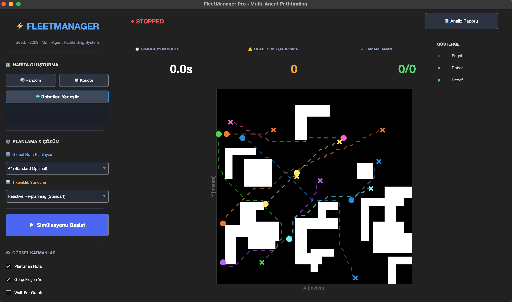
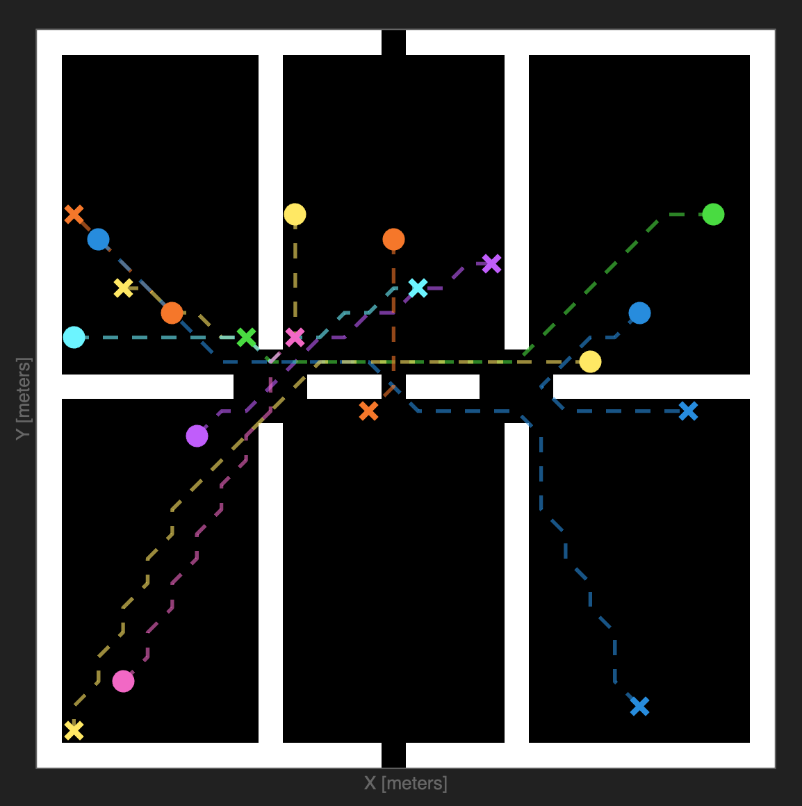
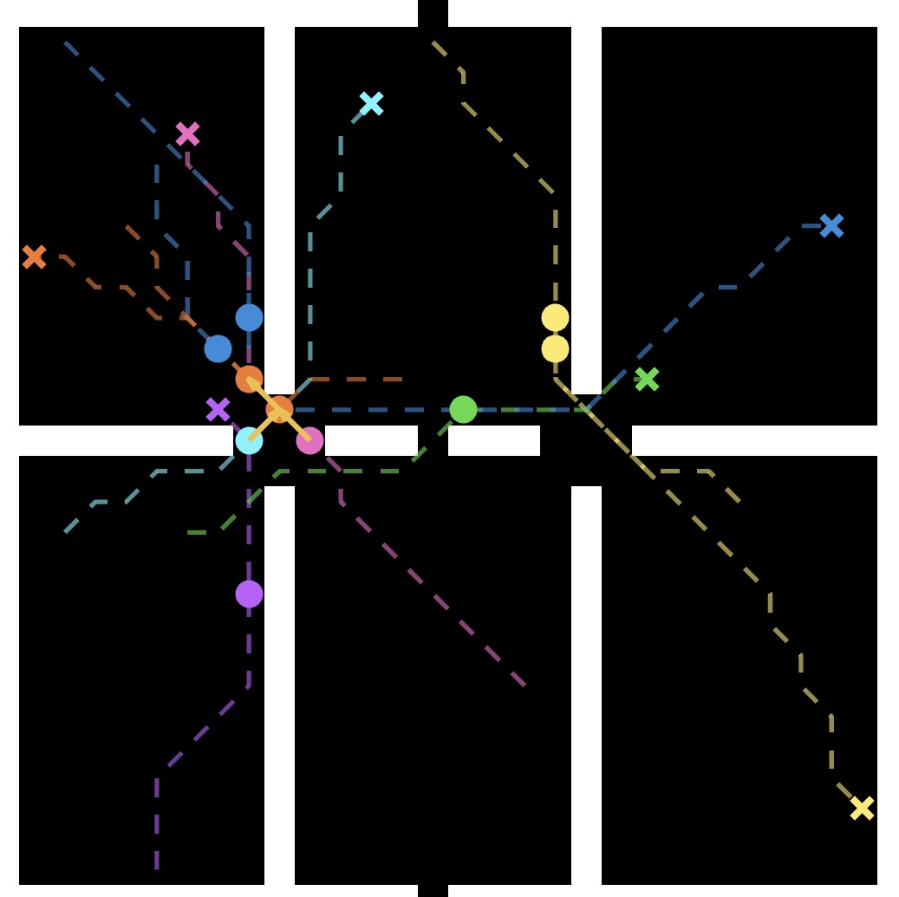
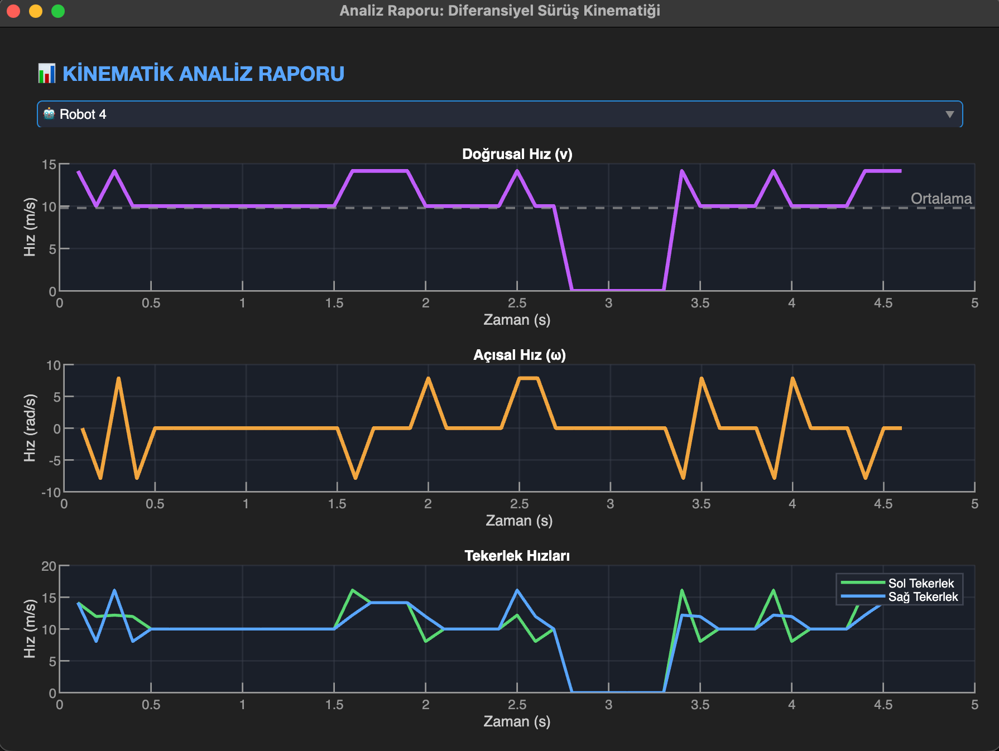

# FleetManager — Multi-Robot Pathfinding Simulation

**FleetManager** is an interactive MATLAB application for visualizing path planning and movement coordination in a simulated fleet of **10 autonomous mobile robots**. It combines grid-based mapping, selectable pathfinding algorithms, basic collision avoidance, reactive re-planning, and differential-drive kinematic analysis.

Developed as an academic project using programmatic MATLAB App Designer components (`uifigure`, `uiaxes`, and UI controls).

## Application Preview



## Features

- **10 simulated robots** with automatically generated start and destination positions.
- **Two grid-map scenarios:** a randomly generated 50 × 50 occupancy grid (approximately 20% obstacles), and a 30 × 30 narrow-corridor layout for congestion testing.
- **Three path planners:** A* (using MATLAB's `plannerAStarGrid`), plus custom Breadth-First Search (BFS) and Depth-First Search (DFS).
- **Reactive re-planning:** robots wait when another robot blocks their next position; repeated blocking triggers a new A* route that treats other robots' current positions as obstacles.
- **Wait-for visualization** and a simple waiting-dependency cycle count during simulation.
- **Live metrics:** elapsed simulation time, detected/resolved conflict count, and completed tasks.
- **Kinematic analysis:** plots of linear velocity, angular velocity, and approximate left/right wheel velocities derived from recorded robot trajectories.

## Screenshots

### Narrow-Corridor Scenario



### Congestion / Deadlock Scenario



### Differential-Drive Kinematic Analysis



## Requirements

- **MATLAB** (a version that supports `plannerAStarGrid`, introduced in R2020b).
- **Navigation Toolbox**, for `binaryOccupancyMap`, `plannerAStarGrid`, and related map/coordinate functions.
- A MATLAB environment capable of opening `uifigure` graphical interfaces.

> This repository contains a `.m` class file. It does not require an `.mlapp` file, a separate dataset, or additional third-party MATLAB packages.

## Run the Application

1. Download or clone this repository.
2. Open MATLAB and set the **Current Folder** to the project directory.
3. In the MATLAB Command Window, run:

   ```matlab
   app = FleetManagerApp;
   ```

4. Click **Random** or **Koridor** to generate a map.
5. Click **Robotları Yerleştir** (Place Robots) to assign robot start and goal positions.
6. Choose a global path planner: **A***, **BFS**, or **DFS**.
7. Click **Simülasyonu Başlat** (Start Simulation). Use the same button to pause/resume.
8. After trajectory data has been recorded, click **Analiz Raporu** (Analysis Report) to inspect the kinematic charts.

To close the application programmatically:

```matlab
delete(app);
```

## Implementation Notes

| Component | Implementation |
| --- | --- |
| Map representation | `binaryOccupancyMap` |
| Global search | Built-in grid A* or custom 4-direction BFS / DFS |
| Robot fleet | 10 simulated agents |
| Map presets | Random obstacles / narrow corridors |
| Conflict response | Waiting and reactive A* re-planning |
| Kinematic model | Differential-drive equations using an assumed wheel separation of `L = 0.5 m` |

Start-to-goal distances are sampled across three categories: short (robots 1–3), medium (robots 4–7), and long (robots 8–10). A randomly generated seed is displayed by the application for reference.

## Current Limitations

This is an **educational simulator**, not a production-ready multi-robot traffic management system or a formal collision-free MAPF solver.

- The interface exposes a **Priority Wait** option, but the current simulation logic uses reactive re-planning regardless of this selection.
- The **Gerçekleşen Yol** (Actual Path) checkbox is present, but actual-path drawing is not implemented in the main map; recorded trajectories are instead used in the analysis window.
- Conflict/deadlock statistics are heuristic indicators, not a formally validated deadlock-resolution benchmark.
- The program was packaged for GitHub from the project source; compatibility has **not** been independently tested across MATLAB releases.

## License

This project is released under the [MIT License](LICENSE).

## Author

**Mammad Poladli**
